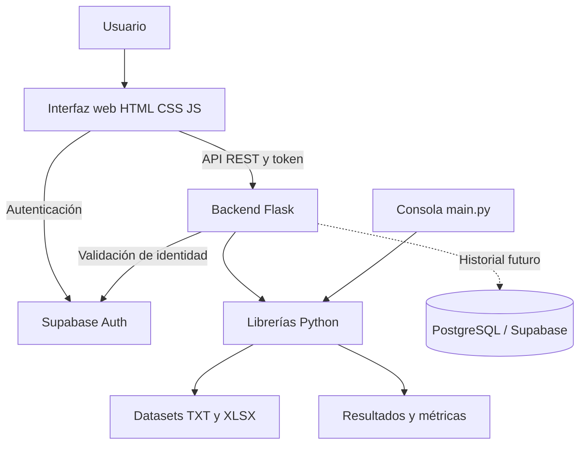

<div align="center">

# 🛡️ DataProcess Secure

### Plataforma de procesamiento de datos y ciberseguridad

**Estructuras de datos · Algoritmos · Análisis de rendimiento · Seguridad informática**


[Descripción](#-descripción) · [Instalación](#-instalación) · [Ejecución](#-ejecución) · [Seguridad](#-ciberseguridad) · [Roadmap](#-roadmap)

</div>

---

## 📖 Descripción

**DataProcess Secure** es un proyecto académico orientado al procesamiento de conjuntos de datos numéricos mediante estructuras de datos, algoritmos de ordenamiento y métodos de búsqueda implementados en Python. Integra una interfaz web con Flask y autenticación mediante Supabase.

Su objetivo es analizar la eficiencia de los algoritmos, conservar los registros duplicados, generar resultados exportables e incorporar principios de ciberseguridad al procesamiento de información.

## ✨ Funcionalidades

- Carga de archivos TXT y XLSX.
- Gestión de datos mediante listas ligadas.
- Ocho algoritmos de ordenamiento interno, ascendente y descendente.
- Tres métodos de búsqueda con identificación de coincidencias.
- Ordenamiento externo mediante bloques y mezclas.
- Medición de tiempos de ejecución y comparación de algoritmos.
- Exportación de resultados en TXT y XLSX.
- Interfaz web con panel de control y visualización de datos.
- Registro e inicio de sesión mediante Supabase Auth.
- Cálculo de huellas digitales SHA-256.

> La integración web de los algoritmos y las exportaciones está pendiente de validación completa. El historial persistente y los controles avanzados de seguridad forman parte del desarrollo futuro.

## 🎬 Demostración

<!-- Cuando tengas una grabación real, guarda el GIF en Web/img/demo.gif y elimina los delimitadores de este comentario para mostrarlo:
<div align="center">
  
</div>
-->

Demostración del sistema: próximamente.

## 📊 Conjuntos de datos

| Archivo | Formato | Registros |
|---|---|---:|
| `dataset_1000_duplicados.txt` | TXT | 1,000 |
| `dataset_5000_duplicados.xlsx` | XLSX | 5,000 |

Ambos conjuntos contienen números enteros con duplicados, los cuales se conservan durante el procesamiento.

## ⚙️ Algoritmos implementados

| Ordenamiento | Complejidad temporal promedio | Peor caso |
|---|---|---|
| Bubble Sort | O(n²) | O(n²) |
| Selection Sort | O(n²) | O(n²) |
| Insertion Sort | O(n²) | O(n²) |
| Shell Sort | Depende de los incrementos | Depende de los incrementos |
| Quick Sort | O(n log n) | O(n²) |
| Merge Sort | O(n log n) | O(n log n) |
| Radix Sort | O(d(n + b)) | O(d(n + b)) |
| Heap Sort | O(n log n) | O(n log n) |

En Radix Sort, `d` representa el número de dígitos procesados y `b` la base utilizada.

| Búsqueda | Complejidad de consulta | Consideraciones |
|---|---|---|
| Secuencial | O(n) | No requiere orden previo |
| Binaria | O(log n + k) | Requiere datos ordenados |
| Hash | O(1 + k) esperado | Requiere construir un índice previamente |

`k` es el número de coincidencias devueltas. La preparación de datos y del índice se considera por separado.

El ordenamiento externo utiliza bloques ordenados y mezclas sucesivas para procesar archivos sin cargar todo su contenido durante la fase de ordenamiento.

## 🏗️ Arquitectura



## 📁 Estructura del proyecto

```text
Procesamiento_De_Datos/
├── datasets/                 # Archivos de entrada
├── Estructura/               # Listas ligadas
├── Resultados/               # Archivos generados
├── src/
│   ├── Busquedas/            # Métodos de búsqueda
│   ├── Ordenamientos/        # Ordenamientos internos y externos
│   ├── Procesamiento/        # Lectura, gestión y exportación
│   └── Util/                 # Cronómetro y utilidades
├── Backend/
│   ├── __init__.py
│   ├── app.py                # Servidor Flask
│   ├── api.py                # Rutas REST
│   └── autenticacion.py      # Validación de identidad
├── Web/
│   ├── index.html
│   ├── login.html
│   ├── registro.html
│   ├── recuperar.html
│   ├── dashboard.html
│   ├── css/
│   ├── js/
│   └── img/
├── main.py                   # Programa de consola
├── requirements.txt
├── .gitignore
└── README.md
```

## 📋 Requisitos

- Python 3.10 o superior (recomendado).
- Git.
- Visual Studio Code (opcional).
- PowerShell para los comandos de Windows.
- Proyecto de Supabase configurado para la autenticación web.
- Conexión a internet para Supabase y recursos externos de la interfaz.

## 🚀 Instalación

Ejecutar desde PowerShell:

```powershell
# Clonar el repositorio (sustituir por la URL real)
git clone URL_DEL_REPOSITORIO

# Entrar a la carpeta del proyecto
cd Procesamiento_De_Datos

# Crear el entorno virtual
python -m venv .venv

# Activar el entorno virtual
.\.venv\Scripts\Activate.ps1

# Instalar las dependencias
python -m pip install -r requirements.txt
```

### 🔧 Si PowerShell bloquea la activación

```powershell
Set-ExecutionPolicy -Scope Process -ExecutionPolicy Bypass
.\.venv\Scripts\Activate.ps1
```

Este cambio solo afecta a la sesión actual de PowerShell. Utilízalo únicamente en un entorno de confianza.

## 🔑 Configuración de Supabase

1. Crear o abrir un proyecto en Supabase.
2. Habilitar el proveedor de autenticación por correo electrónico.
3. Configurar la URL del proyecto y la clave pública `publishable` en `Web/js/supabase.js`, según la configuración del cliente.
4. Configurar las variables de entorno que utilice `Backend/autenticacion.py` para validar los tokens.
5. Configurar las URL de redirección para confirmación de correo y recuperación de contraseña.

Ejemplo orientativo de `.env` (los nombres deben coincidir con el backend):

```dotenv
SUPABASE_URL=https://TU_PROYECTO.supabase.co
SUPABASE_KEY=TU_CLAVE_PUBLICA
```

Nunca publicar contraseñas de PostgreSQL, claves secretas, claves `service_role` ni tokens de sesión. La clave `publishable` está diseñada para uso público, pero no sustituye las políticas RLS.

## ▶️ Ejecución

### Modo consola

```powershell
python main.py
```

### Modo web — Flask

Desde la raíz del proyecto y con el entorno virtual activado:

```powershell
python -m Backend.app
```

Abrir [http://localhost:8000](http://localhost:8000) (o el puerto indicado en la terminal).

| Página | Dirección local |
|---|---|
| Inicio | http://localhost:8000/ |
| Iniciar sesión | http://localhost:8000/login.html |
| Registro | http://localhost:8000/registro.html |
| Dashboard | http://localhost:8000/dashboard.html |
| Estado de la API | http://localhost:8000/api/estado |

Para detener el servidor, presionar `Ctrl + C`.

> No utilizar `python -m http.server` para ejecutar la aplicación completa: únicamente sirve archivos estáticos y no ejecuta la API Flask.

## 🔌 API REST

| Método | Ruta | Función |
|---|---|---|
| GET | `/api/estado` | Estado del backend |
| GET | `/api/datasets/<formato>` | Cargar dataset |
| POST | `/api/ordenar` | Ordenamiento interno |
| POST | `/api/buscar` | Búsqueda |
| POST | `/api/externo` | Ordenamiento externo |
| POST | `/api/rendimiento` | Comparación de algoritmos |
| POST | `/api/exportar` | Exportar resultados |

Consultar las rutas registradas:

```powershell
python -m flask --app Backend.app routes
```

Las rutas de procesamiento están diseñadas para recibir el token de acceso de Supabase mediante `Authorization: Bearer <token>`. La validación efectiva del acceso debe comprobarse mediante pruebas.

## 🔒 Ciberseguridad

El proyecto se orienta a los tres principios de la seguridad de la información (CIA):

| Principio | Aplicación |
|---|---|
| Confidencialidad | Autenticación, autorización y aislamiento de datos por usuario |
| Integridad | SHA-256, validación de entradas y conservación de registros |
| Disponibilidad | Control de recursos, manejo de errores y límites de solicitudes |

| Control | Estado |
|---|---|
| Supabase Auth | Integrado |
| SHA-256 en el navegador | Implementado en la interfaz |
| Validación de tokens en Flask | Pendiente de verificación integral |
| Políticas Row Level Security (RLS) | Pendiente de verificación |
| Auditoría persistente del servidor | Planificado |
| Roles y permisos | Planificado |
| Rate limiting, MFA y CSP | Planificado |
| HTTPS en producción | Planificado |

SHA-256 permite comparar el contenido de un archivo con una huella de referencia confiable; por sí solo no garantiza la autenticidad del archivo.

## 🧪 Pruebas y rendimiento

```powershell
python prueba_ordenamientos.py
python prueba_busquedas.py
python prueba_ordenamiento_externo.py
```

La comparación de rendimiento debe utilizar copias independientes de los mismos datos originales, el mismo sentido de ordenamiento y condiciones equivalentes de ejecución. Los tiempos pueden variar según el equipo y la carga del servidor.

## 🗄️ Persistencia de datos — propuesta

Supabase y PostgreSQL permitirán consultar el historial personal desde distintos dispositivos. Se propone almacenar perfiles, datasets procesados, ordenamientos, búsquedas, ordenamientos externos, rendimiento, auditoría, verificaciones de integridad y exportaciones. Cada registro privado deberá estar asociado al usuario autenticado y protegido mediante políticas RLS.

## 🗺️ Roadmap

- [x] Estructuras de datos y listas ligadas.
- [x] Lectura de archivos TXT y XLSX.
- [x] Ocho algoritmos de ordenamiento interno.
- [x] Tres métodos de búsqueda.
- [x] Ordenamiento externo en Python.
- [x] Interfaz web y autenticación Supabase.
- [x] Registro de las siete rutas Flask.
- [ ] Validación integral de la conexión web con Python.
- [ ] Historial persistente en PostgreSQL.
- [ ] Perfil de usuario y panel de administración.
- [ ] Auditoría persistente y políticas RLS verificadas.
- [ ] Seguridad avanzada y pruebas de autorización.
- [ ] Publicación en internet.

## 🌐 Despliegue futuro

Arquitectura propuesta: **Vercel** para la interfaz, **Render** para Flask y **Supabase** para autenticación y PostgreSQL. También se contempla alojar la interfaz y Flask juntos en Render para simplificar la configuración. El despliegue separado requerirá configurar la URL de la API, CORS y HTTPS.

Actualmente el proyecto se ejecuta en un entorno local; no se afirma que esté publicado.

## 👨‍💻 Autoría

Proyecto académico de estructuras de datos, procesamiento de información y ciberseguridad.

<!-- Agregar aquí nombre, institución, asignatura y colaboradores si corresponde. -->

---

<div align="center">

**DataProcess Secure**

🔐 Procesamiento eficiente · Integridad de datos · Seguridad informática

</div>
